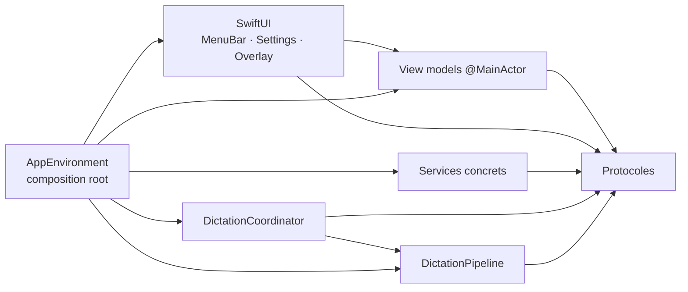

# DictaMac

DictaMac est une application macOS de barre de menus pour dicter du texte dans n'importe quelle
application. Maintenez `fn`, parlez, puis relâchez la touche : la voix est transcrite localement avec
WhisperKit, éventuellement nettoyée, puis collée dans le champ actif.

## Fonctionnalités

- Déclenchement par maintien de `fn` seule, avec filtrage des appuis de moins de 300 ms.
- Capture micro locale et transcription WhisperKit incrémentale.
- Langue fixe ou détection automatique, vocabulaire personnalisé et modèle configurable.
- Nettoyage désactivé, par règles locales, par LLM local MLX ou via l'API OpenAI.
- Collage automatique sans voler le focus, avec restauration du contenu précédent du presse-papiers.
- Repli sur une simple copie dans le presse-papiers lorsque le collage n'est pas possible.
- Historique local optionnel des 20 dernières dictées, lancement à la connexion et sons de feedback.
- Indicateur flottant, mesures de latence, journaux rotatifs et benchmark Whisper en build Debug.

## Architecture

`AppEnvironment` est l'unique composition root : il crée les stores, services, modèles observables,
pipeline et coordinateur, puis les injecte explicitement. L'interface comprend un panneau de barre de
menus, un overlay non activant et des réglages à navigation latérale. Les vues de réglages délèguent
leurs mutations à des view models `@MainActor`, eux-mêmes branchés sur des protocoles testables et sur
`SettingsStoring`.



Les interfaces substituables de l'orchestration vivent dans `Coordination/Protocols`. Les tokens et
composants visuels communs (`SettingsCard`, `SettingsRow`, badges, boutons et callouts) vivent dans
`UI/DesignSystem`. Les chaînes SwiftUI sont extraites dans `Localizable.xcstrings`, avec le français
comme langue source.

## Prérequis

- Mac Apple Silicon sous macOS 14 ou plus récent.
- Xcode avec la prise en charge de Swift 5.9 ou plus récent.
- Une équipe Apple Development configurée dans Xcode pour signer l'application localement.
- Une connexion réseau au premier lancement d'un modèle, afin de télécharger ses fichiers.
- Une clé API OpenAI uniquement si le mode de nettoyage Cloud est utilisé.

## Build et lancement

1. Ouvrez `DictaMac.xcodeproj` dans Xcode.
2. Sélectionnez la target **DictaMac**, puis **Signing & Capabilities**.
3. Laissez **Automatically manage signing** activé et choisissez votre propre valeur dans **Team**.
   Le dépôt laisse volontairement `DEVELOPMENT_TEAM` vide : ce choix de signature reste local à Xcode.
4. Choisissez **My Mac** comme destination, puis lancez l'application avec **Run** (`⌘R`).

Les dépendances Swift Package Manager (WhisperKit et MLX Swift) sont résolues par Xcode. Pour un build
en ligne de commande, conservez un Derived Data persistant et limitez la parallélisation :

```sh
taskpolicy -b xcodebuild \
  -project DictaMac.xcodeproj \
  -scheme DictaMac \
  -destination 'platform=macOS' \
  -derivedDataPath ~/Library/Caches/DictaMac-Codex-DD \
  -jobs 4 \
  build-for-testing
```

## Installation

Pour compiler DictaMac en Release, remplacer l’éventuelle installation existante dans
`/Applications`, puis relancer l’application :

```sh
./scripts/install.sh
```

Le script refuse de démarrer si un autre `xcodebuild` est actif, utilise le cache persistant
`~/Library/Caches/DictaMac-Codex-DD`, limite la compilation à 4 jobs et l’exécute en priorité basse.
Il demande le mot de passe administrateur uniquement si `/Applications` n’est pas accessible en
écriture. Les autorisations macOS étant associées à l’identité signée de l’application, conservez la
même équipe de signature entre les installations.

## Première configuration

Au premier lancement, ouvrez **Réglages…** depuis le panneau de la barre de menus,
puis accordez les trois autorisations demandées :

- **Microphone** pour enregistrer la voix ;
- **Surveillance de l'entrée** pour détecter la touche `fn` ;
- **Accessibilité** pour simuler `⌘V` dans l'application active.

Dans **Réglages Système → Clavier**, réglez **« Appuyer sur 🌐 pour : »** sur **« Ne rien faire »** afin
de réserver la touche `fn` à DictaMac. Si macOS ne reflète pas immédiatement un changement
d'autorisation, quittez puis relancez l'application.

## Modèles

La transcription utilise WhisperKit et reste locale. Sur les Mac disposant d'au moins 16 Go de mémoire,
le modèle recommandé est `openai_whisper-large-v3-v20240930_turbo`. Sous 16 Go, DictaMac recommande
`small`, qui sert également de modèle de repli si le modèle demandé ne peut pas être chargé. Le modèle,
la langue et le vocabulaire peuvent être changés dans les réglages.

Les modèles Whisper sont téléchargés dans `~/Library/Application Support/DictaMac/Models`. Le nettoyage
local utilise par défaut `mlx-community/Qwen2.5-3B-Instruct-4bit` (environ 1,74 Go), ou
`mlx-community/Qwen2.5-1.5B-Instruct-4bit` (environ 869 Mo) sur les machines moins dotées. Ils sont
stockés dans `~/Library/Application Support/DictaMac/Models/Cleanup`.

## Nettoyage du texte

Quatre modes sont disponibles :

- **Désactivé** : le résultat brut de WhisperKit est inséré.
- **Rapide (règles)** : traitement déterministe et local des hésitations, répétitions, espaces,
  majuscule initiale et ponctuation finale. C'est le mode par défaut.
- **Local (LLM)** : nettoyage sur le Mac avec MLX et un modèle Qwen 2.5 quantifié. Les textes courts
  utilisent les règles rapides ; si le modèle n'est pas prêt, dépasse le délai ou produit un résultat
  suspect, DictaMac conserve le texte brut ou applique le repli local prévu.
- **Cloud** : seul le texte transcrit est envoyé à l'API OpenAI Responses. Le modèle par défaut est
  `gpt-4.1-mini`, configurable dans les réglages. La clé API est conservée dans le Trousseau macOS
  (Keychain), jamais dans le dépôt ni dans les préférences en clair. Après trois secondes ou en cas
  d'erreur, le texte brut est utilisé.

## Confidentialité

L'audio du microphone, la transcription WhisperKit, les règles rapides et le nettoyage MLX restent sur
le Mac. L'audio n'est pas envoyé à OpenAI. Les modèles sont téléchargés depuis leurs hébergeurs, puis
exécutés localement.

Lorsque le mode **Cloud** est sélectionné, le texte transcrit est envoyé à OpenAI avec l'instruction de
nettoyage et `store: false`. L'utilisation de cette fonction reste soumise aux conditions et à la
politique de confidentialité d'OpenAI. L'historique, activé par défaut, conserve au maximum 20 textes
dans `~/Library/Application Support/DictaMac/History/transcriptions.json` avec des permissions `0600` ;
il peut être désactivé ou effacé depuis les réglages. Aucun texte dicté ni aucune clé API n'est écrit
dans les journaux de diagnostic.

## Journaux

Les diagnostics opérationnels se trouvent dans `~/Library/Logs/DictaMac`. Le fichier `session.log`
est limité à 2 Mio et trois fichiers sont conservés au total. Les journaux contiennent les étapes,
durées, informations de mémoire et erreurs techniques, mais pas le contenu des dictées. Le dossier peut
aussi être ouvert depuis l'onglet **Diagnostic** des réglages.

## Dépannage

- **`fn` ne déclenche rien** : vérifiez l'autorisation Surveillance de l'entrée, le réglage 🌐/`fn`
  « Ne rien faire », puis relancez DictaMac après toute modification des autorisations.
- **Aucun son n'est enregistré** : autorisez le Microphone et vérifiez le périphérique d'entrée actif
  dans Réglages Système → Son.
- **Le texte est copié mais pas collé** : autorisez Accessibilité. DictaMac copie volontairement le
  résultat si aucun champ éditable n'est ciblé ou si la saisie sécurisée de macOS est active ; utilisez
  alors `⌘V`.
- **Le modèle ne charge pas** : vérifiez la connexion et l'espace disque, essayez le modèle `small`,
  ou le Qwen 1,5B pour réduire la pression mémoire. Un téléchargement MLX annulé peut reprendre.
- **Le nettoyage Cloud ne fonctionne pas** : enregistrez une clé valide dans les réglages et vérifiez
  le nom du modèle. Le texte brut reste inséré en cas d'échec ou de timeout.
- **Le comportement reste inexpliqué** : consultez `~/Library/Logs/DictaMac/session.log` et les mesures
  de l'onglet Diagnostic.

## Procédure d’urgence

Procédez par niveaux et passez au suivant uniquement si le précédent ne répond pas :

1. Maintenez `⌃⌥⌘` (configurable dans **Réglages → Général**). Le callback du tap clavier annule la
   session sans dépendre du main thread, arrête l’audio et demande le déchargement des modèles. Si
   DictaMac ne revient pas à l’état inactif sous 1,5 seconde, le processus se termine.
2. Attendez le watchdog : son thread dédié contrôle toutes les 500 ms le main thread, les budgets des
   étapes et la mémoire. Il tente d’abord annulation/déchargement/alerte, puis écrit
   `EMERGENCY_EXIT reason=…` et quitte après trois secondes sans rétablissement.
3. Dans Terminal, forcez uniquement l’application : `killall -9 DictaMac`.
4. Si le Mac reste saturé par DictaMac ou une compilation, exécutez
   `scripts/emergency-stop.sh`. Le script demande confirmation avant d’arrêter DictaMac,
   `xcodebuild` et `swift-frontend`.

Pour installer un raccourci Terminal pratique depuis la racine du dépôt :

```sh
alias dstop="$PWD/scripts/emergency-stop.sh"
```

Ajoutez cette ligne à `~/.zshrc` pour rendre l’alias permanent. Avant de relancer l’application,
sauvegardez les journaux avec :

```sh
cp -R "$HOME/Library/Logs/DictaMac" "$HOME/Desktop/DictaMac-logs-$(date +%Y%m%d-%H%M%S)"
```

`session.log` ne contient ni texte dicté ni secret. Après une sortie anormale, le lancement suivant
active automatiquement le mode sûr : nettoyage par règles, modèles légers et aucun préchauffage.

## Licence

Aucune licence n'est ajoutée pour le moment.
